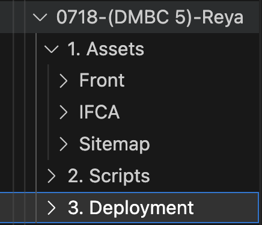
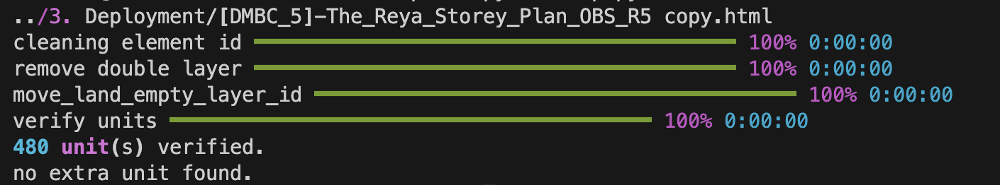

### **Folder Structure**



### **Step 1: Unit Listing**

1. We need to get **IFCA.csv** & **MAP.svg** first before proceeding.
2. Once we get **IFCA.csv**, create a file called `unit.py` (copy from another map) and put it into _2. Scripts_.
3. In `unit.py`, just change the filename to your **IFCA.csv**:

   ```python
   filename = 'IFCA.csv'
   ```

4. A new unit listing will auto-generate into _3. Deployment_.

### **Step 2: Map**

1. To build the HTML, copy another `map.py` and put it into _2. Scripts_.
2. Replace the following lines:

   ```python
   UNIT_LISTING_FILE = 'unit-listing.csv'
   WORKING_FILE = 'Map.svg'
   ```

3. Next, replace the prefix:
   ```python
   unit_prefix = ['Find in map.svg']
   lot_no_phase = ['Find in Unit Listing phase code']
   ```
4. Edit `scale`, `offset_x`, `offset_y` and run `map.py` the HTML looks good with pin placement:
   ```python
   scale = 0.45
   offset_x = 7
   offset_y = 18
   ```
5. Set `skip_pin=True` when it is high-rise.
6. Ensure you can build `map.py` successfully and get a message like:
   

### **Step 3: Setup Map in Front and Front-Admin**

1.  Run `ng g c 'phase_code'` if possible.
2.  Copy another `map.component.ts` and just rename it to your component name.
3.  Add your map into the HTML.
4.  Remove:

    ```xml
    <?xml version='1.0' encoding='utf-8'?>
    ```

5.  Add code below and remove `[class.unit-information]="isUnitInformation"` in front
    ````html
    <div
      #svgWrapper
      class="svg-wrapper fuse-white-bg"
      [class.public]="isPublic"
      [class.allow-live-view]="allowLiveView"
      [class.is-display-block-unit-as-white]="isDisplayBlockUnitAsWhite"
      [class.unit-information]="isUnitInformation"
    >
      ```
    </div>
    ````
6.  add #svg , scale , x and y. scale for how big the circle in The Lab, x and y for position
    ```html
    <svg
    #svg
    id="mySVG"
    scale="0.7"
    xmlns="http://www.w3.org/2000/svg"
    x="0"
    y="8"
    version="1.1"
    viewBox="0 0 584.45 804.11"
    >
    </svg>
    ```
7. For HighRise, need to add:
    - add diagonal hatch after `</style>`
     ```xml
    <pattern id="diagonalHatch" patternUnits="userSpaceOnUse" width="8" height="8">
    <path
        d="M-1,1 l4,-4
            M0,8 l8,-8
            M6,10 l4,-4"
        style="stroke: #82c4b5; stroke-width: 3; opacity: 100%"
    />
    </pattern>
    ```

    - after first div :
   ```html
    <div id="legend" class="legend">
    <table cellpadding="0" cellspacing="0" style="padding: 20px">
        <tr>
        <td class="legend-unit reserved"></td>
        <td class="legend-text">Sold</td>
        <td class="legend-unit selected"></td>
        <td class="legend-text">Selected</td>
        </tr>
    </table>
    </div>
    ```

### **Step 4: CSS For Map**
1. Normal Map
    - just add
        ```scss 
        @import './../../base.scss';
        ```
2. For Highrise
    - Add
        ```scss   
        @import './../../base.scss';

        app-triara {
            .svg-wrapper {
            width: 100%;
            max-width: 100%;
            min-width: 100%;
            border-radius: 8px;
            border: 1px solid rgba(0, 0, 0, 0.12);
            transform: translateZ(0);
            }
            @media screen and (max-width: 600px) {
            #legend {
                visibility: hidden;
                clear: both;
                display: none;
            }
            }
            .legend {
            position: relative;
            z-index: 100;
            padding: 10px;
            background-color: #f8f8f8 !important;
        
            .legend-unit {
                margin-left: -1px;
                margin-top: -1px;
                text-align: center;
                vertical-align: middle;
                border: 1px solid black;
                height: 20px;
                width: 20px;
            }
            .legend-text {
                padding-left: 10px;
                padding-right: 10px;
                font-size: 0.9em;
            }
            .reserved {
                background-color: rgb(208, 0, 0);
            }
            .selected {
                background-image: linear-gradient(135deg, #ffffff 25%, #82c4b5 25%, #82c4b5 50%, #ffffff 50%, #ffffff 75%, #82c4b5 75%, #82c4b5 100%);
            }
            }
            .allow-live-view .unit {
            cursor: default;
            &.inactive {
                .land {
                fill: #ffffff !important;
                opacity: 0.95 !important;
                }
            }
            &.open {
                cursor: pointer !important;
                &.statutory {
                .land {
                    fill: #dfedd4;
                }
                }
                &.open-market {
                .land {
                    fill: #f4b8d8;
                }
                }
                &.selected {
                .land {
                    fill: url(#diagonalHatch) !important;
                    opacity: 1 !important;
                }
                }
            }
            &.reserved {
                .land {
                fill: rgb(255, 37, 37);
                opacity: 1 !important;
                }
                &.selected {
                .land {
                    fill: url(#diagonalHatch) !important;
                    stroke: #ff0000 !important;
                    stroke-width: 1 !important;
                }
                }
            }
            &.sold {
                .land {
                fill: rgb(208, 0, 0) !important;
                opacity: 1 !important;
                }
                &.selected {
                .land {
                    fill: url(#diagonalHatch) !important;
                    stroke: #ff0000 !important;
                    stroke-width: 1 !important;
                }
                }
            }
            &.closed {
                .land {
                fill: rgb(208, 0, 0);
                }
            }
            }
            .public.allow-live-view {
            .unit {
                &.reserved {
                .land {
                    fill: rgb(208, 0, 0);
                }
                }
            }
            }
            .non-bumi-customer {
            .unit {
                &.open {
                &.none {
                    cursor: pointer !important;
                }
                &.statutory {
                    cursor: default !important;
                }
                &.open-market {
                    cursor: default !important;
                }
                }
            }
            }
            .unit.selected {
            .land {
                fill: url(#diagonalHatch) !important;
                stroke: #ff0000 !important;
                stroke-width: 1 !important;
            }
            }
        }
        ```