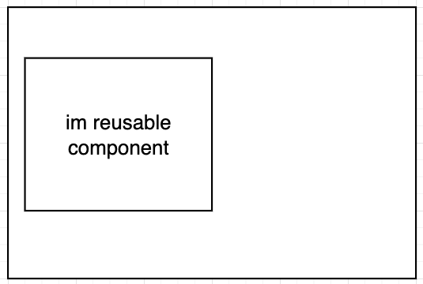
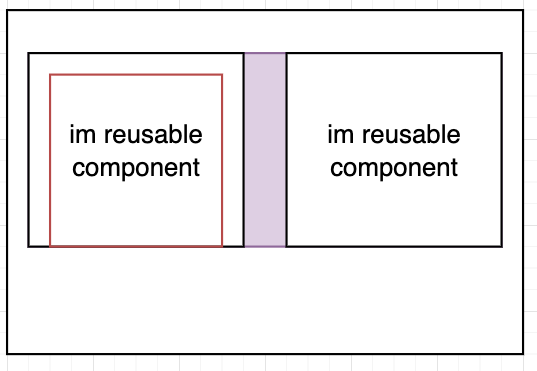
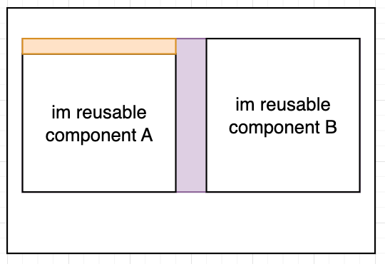

# Creating a component

We know some of the scenario we creating reusable component for other page also.

when creating reusable component, remember to make the component always take full width, meaning we use parent component to control the component

dont set any margin in the reusable component!

eg: margin on reusable component A

it is hard to find why cause this, and it will affect the original flex-col

