# Everything can be Flex and Gap!
Everything can be **settle** by applying Flex and Gap!

## Flex and gap 
now we know, we use outer padding concept d, 
how can we settle the other padding? 

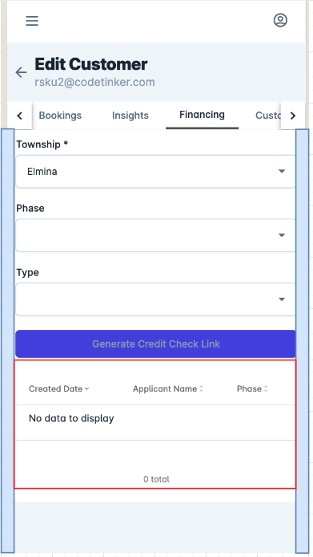

We use flex for all the section, start with the very beginning

eg: `flex flex-col`

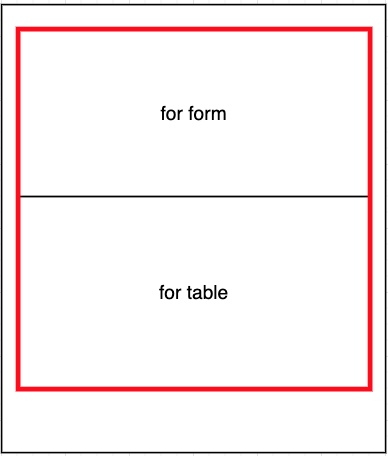

inside form, flex again!

eg: `flex flex-col gap-4 sm:flex-row sm:gap-6`

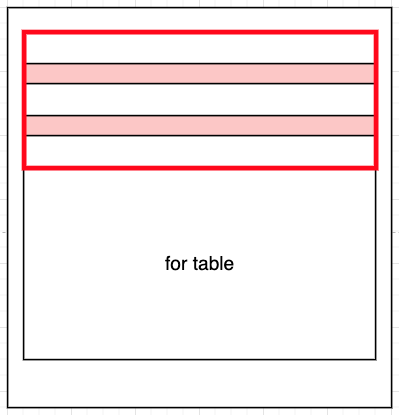

Now we can easily adjust the css for above case, since it is just parent gap, and it will not affect the form gap, no need to add `pt-4` to table

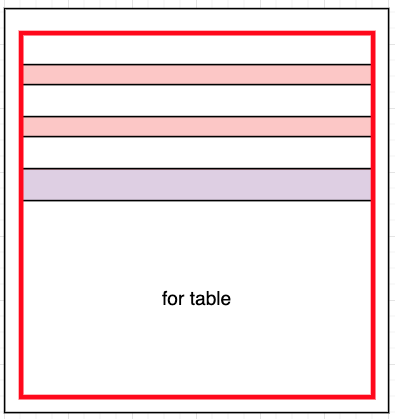

including button beside form, remember to always use **GAP**

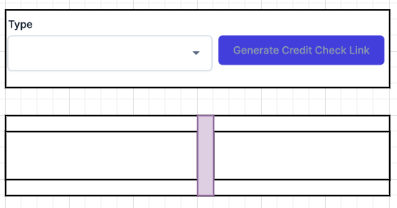

Not `ml-3` !!

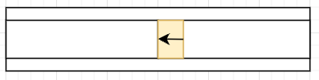

## Special Case

of course, we have some very stupid case that cannot use outer padding

eg: Eh, i want B to take full width can ah?
i dont want padding leh~

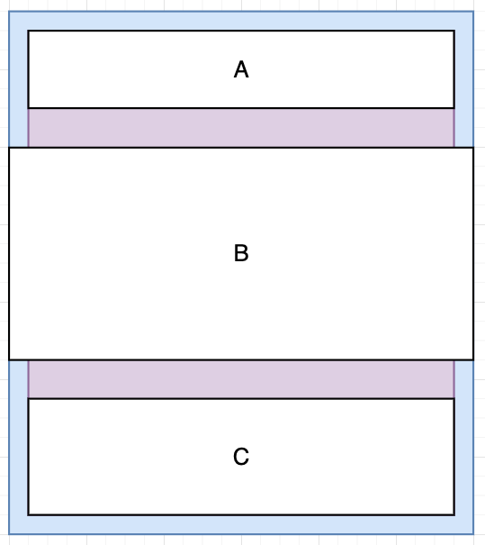

in this happy scenario, 
we cannot do `px-6 pt-6` at section A and `px-6 pb-6` at section B, we know it is pain in the ass if we do mobile and desktop view together

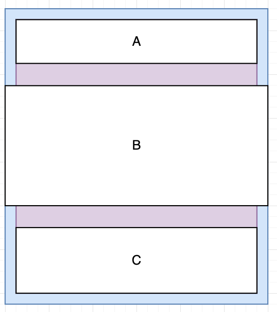

### Solution - padding on each component

My suggestion will be, use margin!

first we keep the py-6 for outer padding, because not affect right?

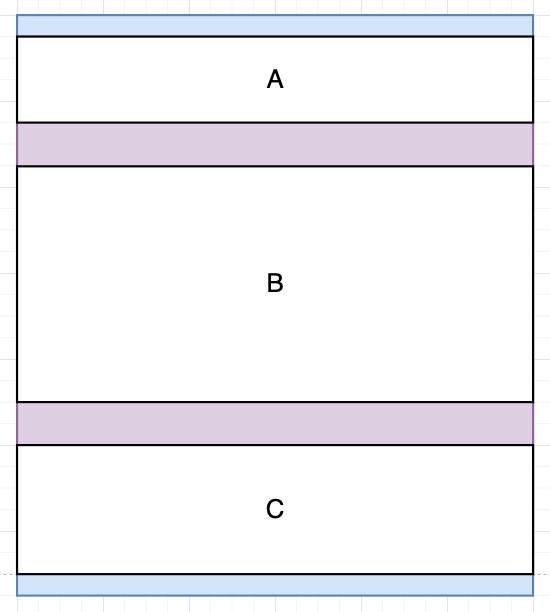

Then, we update all section A and section C with margin,
as we know padding is for inner, margin is for outer

eg: `mx-6`

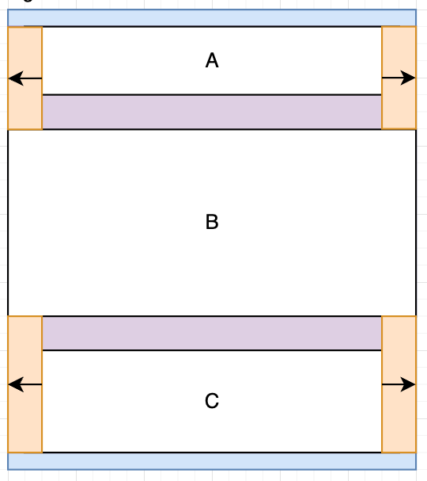

### solution - negative margin
Or another solution is, we keep the **outer padding** concept, and we add in negative margin

eg: -mx-6 (for p-6)

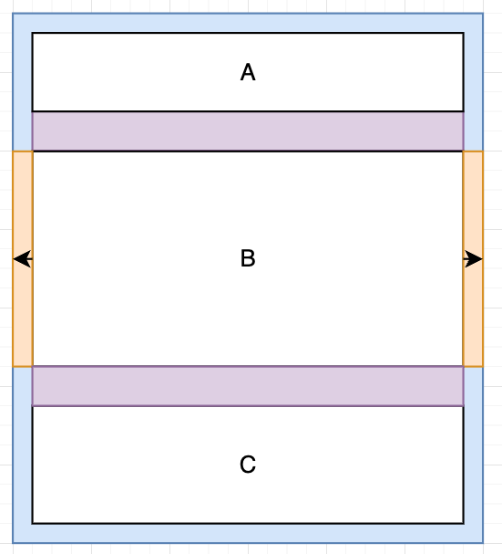

