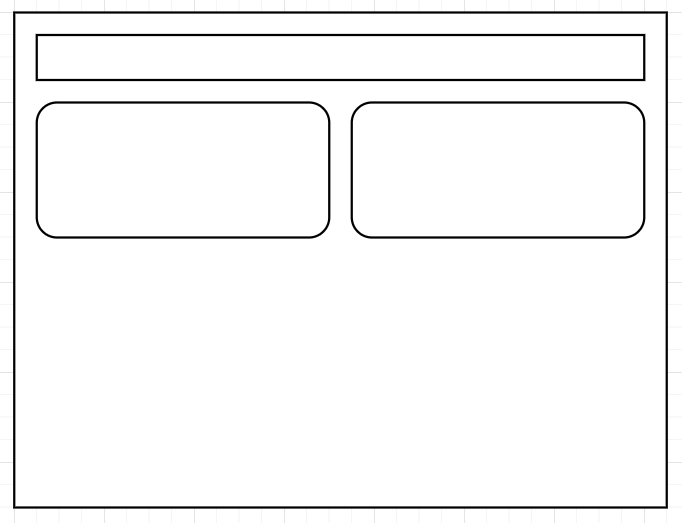
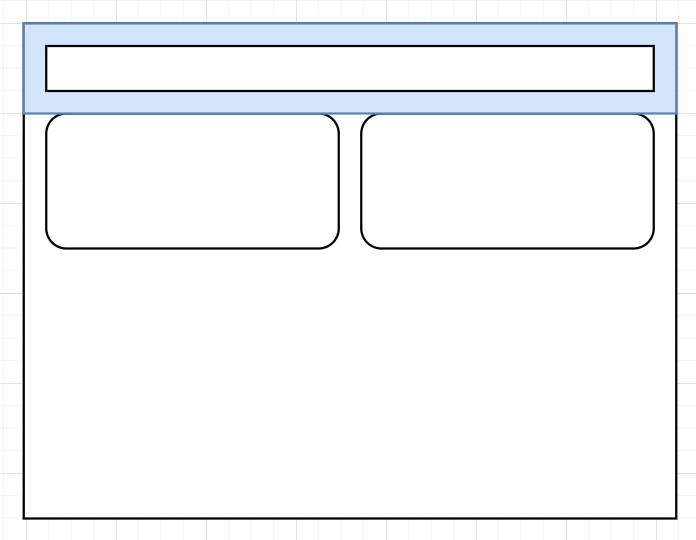
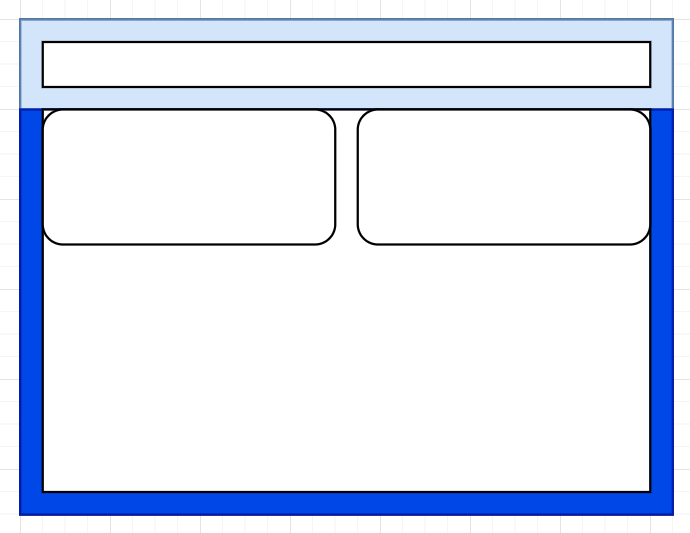
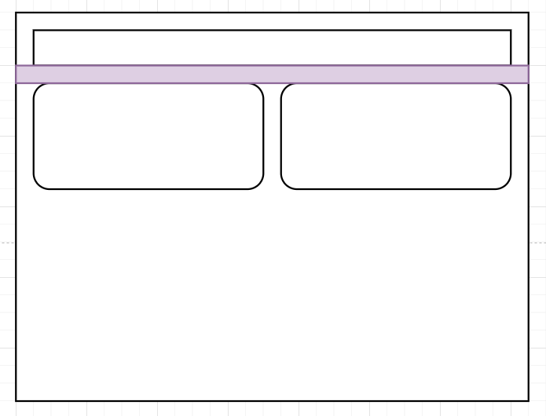
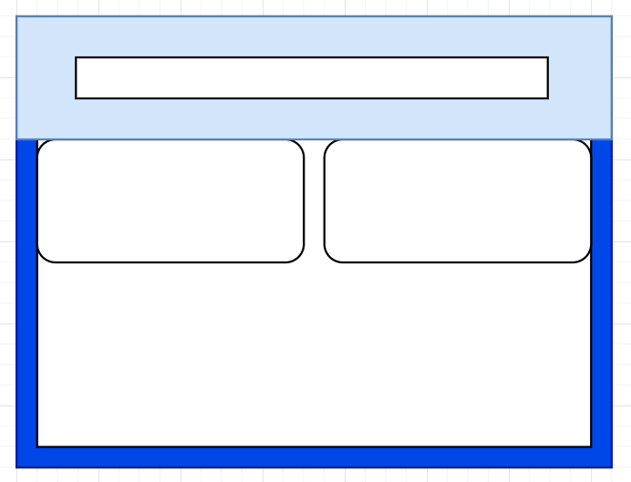
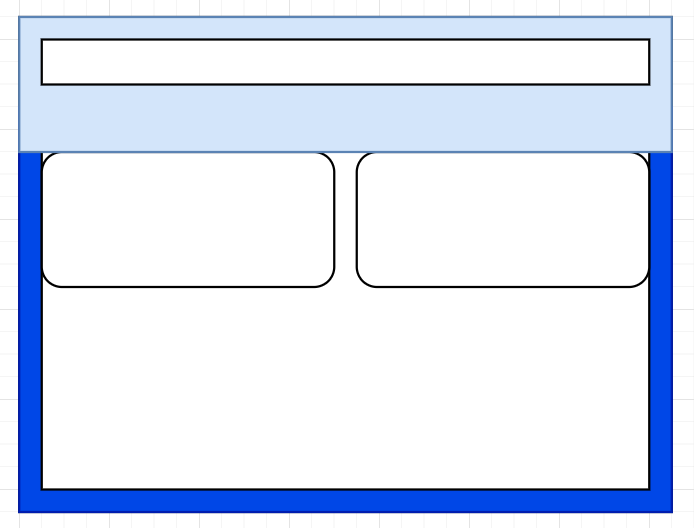
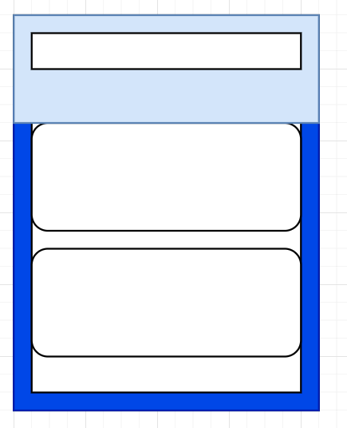
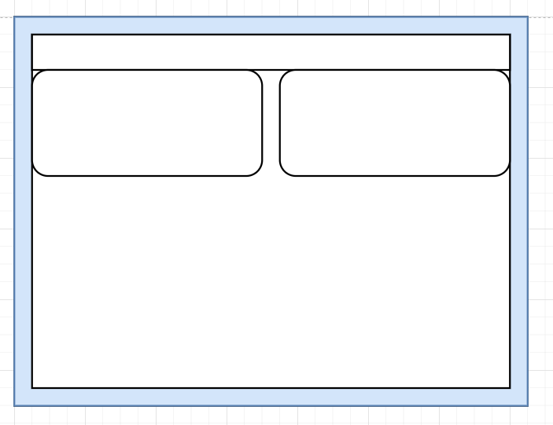
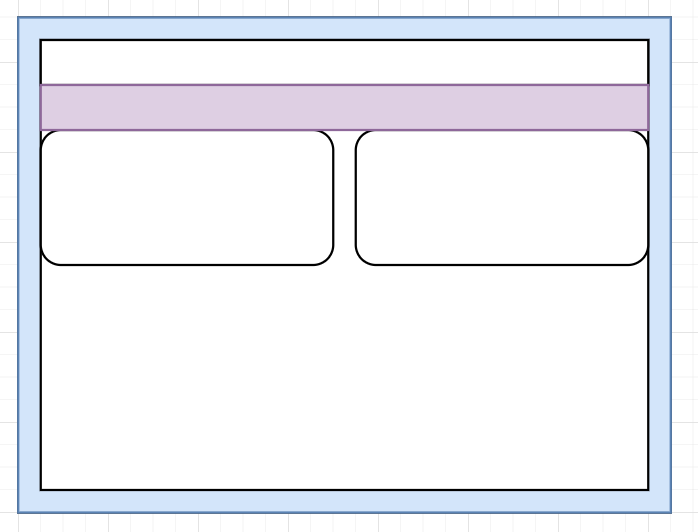

# Design concept
To make sure we can easily maintain responsiveness and padding, we have introduced these Tailwind design concepts.

## Padding Concept

### Problem
The design of our page mostly looks like this:

Problem is our upper side have padding it self

Then when  we do the bottom padding, we often do `pb-6 px-6`

therefore, its hard to update padding, if we want to update the gap between both section.

eg: i want padding between them bigger 

when i do `p-8`, i will headache

In the final solution and most easy and lazy way, i will do this `p-6 pb-8`
or `px-6 pt-6 py-8`,

it solved the problem, but come to mobile...
say i want `p-3` for mobile...
i cannot just update `p-3 sm:p-6`
i have to do `px-3 pt-3 pb-6 sm:px-6 sm:pt-6 sm:pt-8`

### Solution

Outer padding!
to make we easy update, we only set outer padding on first div, you know what i mean

eg: `p-6`

and more we have to make it flex-col right?

final: `p-6 flex flex-col`

When come to update their gap, we are very easy to control

eg: `p-6 flex flex-col` **`gap-6`**

