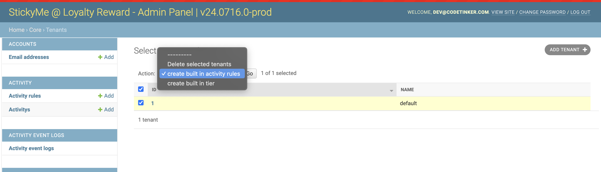
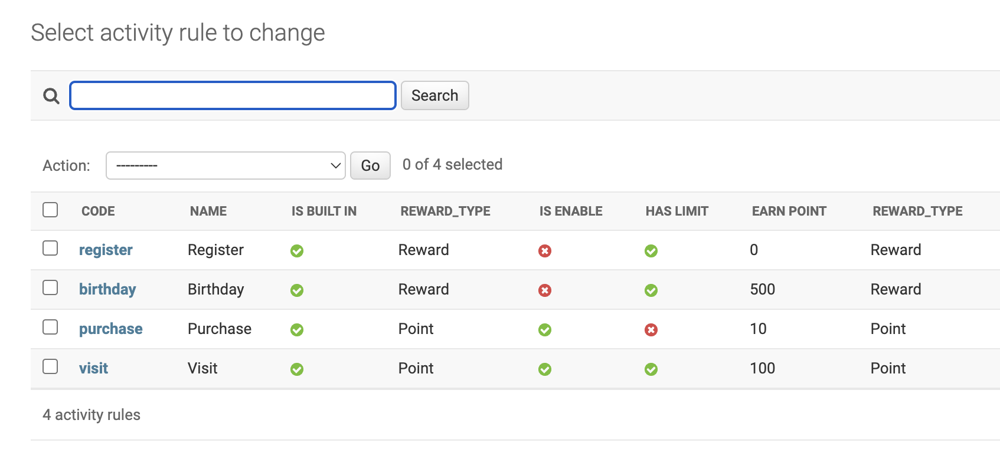
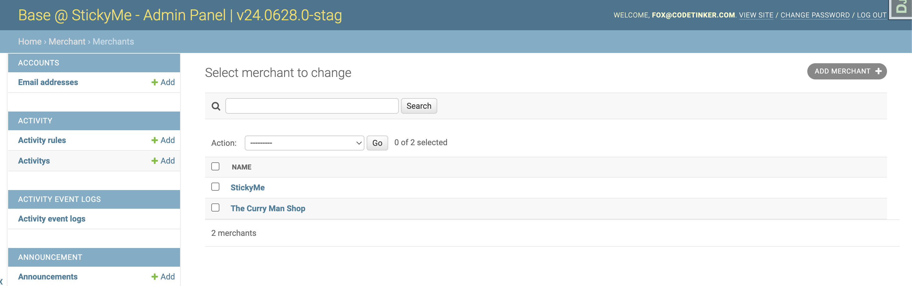
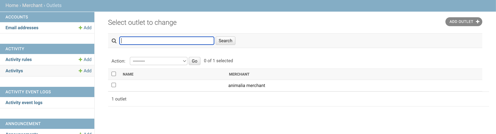
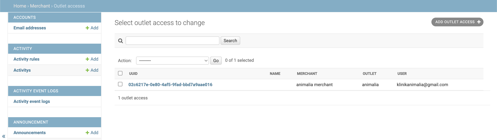
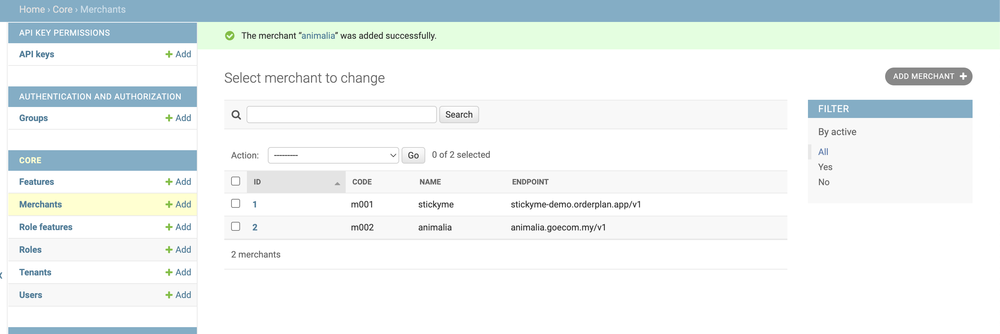

# Configuration Guide: Universal Admin Setup

## Overview

This guide provides comprehensive instructions for configuring the Universal Admin panel for new clients. Follow the steps below to set up essential components, including activity rules, client accounts, merchants, outlets, and optional tiers.

 

## **Admin Panel Configuration**
1. **Create Built In Activity Rules**: Set up activity rules tailored to the client's requirements. 
2. **Create Client Account**: Establish an admin account for the client to access the dashboard.
3. **Create Merchant**: Register a merchant for the client.
4. **Create Outlet**: Set up an outlet under the created merchant and manage access.
5. **Create Tier(optional)**: If required, establish a tier system for client-specific needs.

 

### Step 1: Create Built In Activity Rules:

* Navigate to Tenant > Create Built-In Activity Rule.

* Adjust Activity Settings: Modify the `earn_point` values for `visit` and `purchase` based on the client's specifications. The default value is 1.

### Step 2: Create Account for client:

* Follow the [StickyMe Onboard Checklist](https://docs.google.com/spreadsheets/d/1PSyl_GyXydbveaGWDdZu3pwZEXmgJVtiZ6o-H9Igd0c/edit?gid=0#gid=0)

* <b>Assign Roles and Permissions</b>: Grant the merchant role and relevant feature access, excluding user configuration by default.

### Step 3: Create Merchant:
* <b>Go to the Merchant Section</b> and create a new merchant entry.

### Step 4: Create Outlet:
* <b>Create Outlet</b>: Define the outlet details.

* <b>Assign Account Access</b>: Grant the client account access to the specific outlet.

## **StickyMe Central Admin Panel Configuration**

1. **Create Merchant Endpoint**: Link the new client to the StickyMe Central system.

* Access StickyMe Central Admin: Navigate to the [StickyMe Central Admin Panel](https://stickyme-central.goecom.my/admin).

* Create Merchant Endpoint: Define the new client's endpoint. Add new client's merchant code based on [StickyMe Central Merchant Account](https://docs.google.com/spreadsheets/d/1aHgovM-tFv1tXEAgkNvlWhcqnddYMj-Lt3FXz8dub9Q/edit?gid=46520131#gid=46520131).

 
 

Follow these steps to ensure a complete and accurate setup for new clients in the Universal Admin panel. This configuration enables proper management and access control for all involved parties.