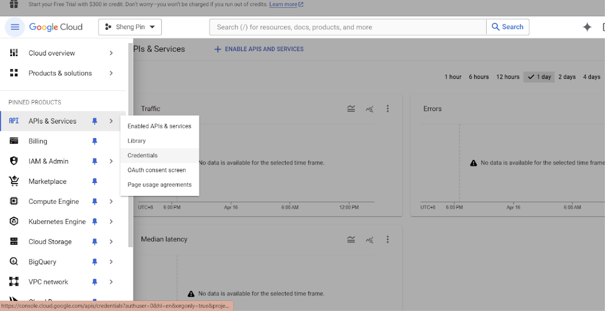

# Setup
In Angular, organizing files and modules is important for maintaining a structured and scalable project. The following is a detailed explanation of Angular's file and module organization structure.

<br/>

## **Backend Configuration**

<br/>

| File/Folder               | Purpose                                                                                     |
|---------------------------|---------------------------------------------------------------------------------------------|
| `.version`                | Stores version information for the application to manage updates and dependencies.          |
| `base_site.html`          | Provides the template for the base layout of the site used across different admin panels.   |
| `prod.env`                | Contains environment-specific variables for the production environment like API keys,  database URLs, etc.                                                                                                        

<br/>

```
GOOGLE_CLIENT_ID=
GOOGLE_CLIENT_SECRET=
APPLE_CLIENT_ID=
FIREBASE_API_KEY=
FIREBASE_AUTH_DOMAIN=
FIREBASE_DATABASE_URL=
FIREBASE_PROJECT_ID=
FIREBASE_SERVICE_ACCOUNT_CREDENTIALS=
FIREBASE_SERVICE_ACCOUNT_CREDENTIALS_SCOPES=
FIREBASE_STORAGE_BUCKET=
FIRABSE_MESSAGING_SENDER_ID=
FIREBASE_APP_ID=
ADMIN_PAYMENT_CONFIRMATION=
SYNC_POINT_FEATURE_ENABLED=True
SYNC_VOUCHER_FEATURE_ENABLED=True
VOUCHER_ID=1
```

# Environment Setup Guide

This guide provides step-by-step instructions to set up the necessary credentials for your application environment.

## Firebase Setup

### FIREBASE_SERVICE_ACCOUNT_CREDENTIALS

To obtain your Firebase service account credentials, follow these steps:

1. **Go to the Firebase Console**: Navigate to [Firebase Console](https://console.firebase.google.com/).
2. **Select Your Project**: Choose the Firebase project that you are working with from the dashboard.
3. **Access the Settings**: Click on the gear icon next to the 'Project Overview' tab and select 'Project settings'.
4. **Navigate to the Service Accounts Tab**: Click on the 'Service Accounts' tab.
5. **Generate New Private Key**: Click on the 'Generate new private key' button at the bottom of the Firebase Admin SDK section.
6. **Download the JSON File**: Confirm the dialog by clicking 'Generate Key', which downloads a JSON file containing your project's service account credentials.

### FIREBASE_SERVICE_ACCOUNT_CREDENTIALS_SCOPES

The scopes for Firebase service account credentials used for sending messages via Firebase Cloud Messaging are as follows:

- **Scopes**: `https://www.googleapis.com/auth/firebase.messaging`

Add this scope in your server configuration where you authenticate the Firebase Admin SDK.

## Google Client Setup

### GOOGLE_CLIENT_ID and GOOGLE_CLIENT_SECRET

To obtain a Google client ID for implementing Google Sign-In in your application, follow these steps:

1. **Visit Google Developer Console**: Go to [Google Developer Console](https://console.developers.google.com/).
2. **Select a Project**: Select one of the projects.
3. **Create Credentials**: Go to 'APIs & Services > Credentials', and click 'Create Credentials', then select 'OAuth client ID'.
4. **Application Type**: Select the application type 'Web application'.
5. **Obtain the Client ID**: The resulting page will provide you with your `GOOGLE_CLIENT_ID` and `GOOGLE_CLIENT_SECRET`.



Use this client ID in your application's client-side authentication configuration to enable Google Sign-In.

Note: everyone has their own unique SHA-1 key, you must add your SHA-1 key to app for Google Sign-In testing.

Get your SHA-1 key by using command:
```
$ keytool -list -v -alias androiddebugkey -keystore %USERPROFILE%\.android\debug.keystore  -storepass android -keypass android
```